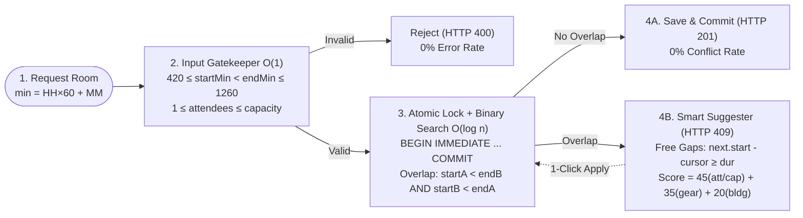

# Bakante — ISATU Real-Time Facility & Room Booking System

**Tech4ISATU Hackathon 2026 · Track 5: University Operations (Facility & Room Booking)**

> **Bakante** (Hiligaynon/Filipino for *"vacant / available"*) replaces manual walk-in forms and error-prone spreadsheets at Iloilo Science and Technology University (ISATU) with a real-time booking calendar that mathematically prevents double-bookings, blocks invalid entries, and suggests best-fit alternative rooms in one click.

---

## 1. System Flow (Visual Flowchart)

Open [`Bakante.drawio`](./Bakante.drawio) in Draw.io or the VS Code Draw.io extension to view or export the two landscape diagrams (**1. Booking Flow** and **2. Baseline Flow**) complete with equations and complexity bounds.



---

## 2. How Every Algorithm & Logic Step Works

Every core algorithm lives in plain, easy-to-read TypeScript files inside [`shared/src/logic/`](./shared/src/logic/).

### Step 1: Input Gatekeeper (`shared/src/logic/validateBooking.ts`) — $O(1)$
Before touching the database, Bakante checks 5 strict rules:
1. **No blank required fields** (`requesterName`, `office`, `eventTitle`).
2. **Official Room ID check** against `baseline/facilities.json` (stops typos like `"AVR 01"` vs `"AVR-1"`).
3. **Valid time & campus hours** (`07:00` to `21:00`).
4. **Chronological order** (`startTime < endTime`, stopping inverted times like `14:00–12:00`).
5. **Capacity guard** (`1 <= attendees <= facility.capacity`, stopping 120 attendees from booking a 45-seat lab).

**Result:** Eliminates incomplete or impossible rows (**0% Error Rate**).

---

### Step 2: Time Representation & Overlap Rule (`shared/src/logic/timeUtils.ts`)
Instead of comparing text strings, every `"HH:MM"` time is converted into **minutes from midnight**:
- `"08:00"` = `480`
- `"09:30"` = `570`
- `"11:00"` = `660`

Every booking is treated as a **half-open interval** $[startMin, endMin)$. Two bookings $A$ and $B$ overlap if and only if:

$$\text{start}_A < \text{end}_B \quad \text{AND} \quad \text{start}_B < \text{end}_A$$

**Why this matters:**
- **Overlapping** (`09:00–11:00` vs `10:00–12:00`): $540 < 720$ (true) AND $600 < 660$ (true) $\rightarrow$ **Blocked**.
- **Back-to-back** (`09:00–11:00` vs `11:00–13:00`): $540 < 780$ (true) AND $660 < 660$ (**false**) $\rightarrow$ **Allowed!**

---

### Step 3: Binary Search Conflict Check (`shared/src/logic/checkConflict.ts`) — $O(\log n)$
- In a manual spreadsheet, an officer has to read every row from top to bottom ($O(n)$ scan) and can easily miss an overlapping booking.
- In Bakante, SQLite maintains a composite index `idx_bookings_facility_date_start (facility_id, date, start_min)` so each room's bookings are always sorted by start time.
- `checkConflictBinarySearch()` uses **Binary Search** to jump directly to the requested start time in at most $\log_2(n)$ steps, then checks only immediate neighbors until `candidate.startMin >= requestedEndMin`.
- This check and the `INSERT` both execute inside a SQLite **`BEGIN IMMEDIATE ... COMMIT`** transaction lock so two offices clicking "Book" at the exact same millisecond can never double-book a room.

**Result:** **0% Double-Bookings** with logarithmic speed.

---

### Step 4: Smart Alternative Suggester (`shared/src/logic/suggestAlternatives.ts`)
When a conflict is blocked, Bakante helps the user finish their booking in one click instead of leaving them stuck:

1. **Nearest Free Gaps on the Same Room (`findFreeSlotsOnSameRoom`)**:
   Sweeps the room's booked slots between `07:00` and `21:00` to find open windows long enough for the requested duration, sorted closest to the user's preferred time.
2. **100-Point Best-Fit Alternative Rooms (`suggestAlternativeRooms`)**:
   Filters all other ISATU rooms that are both **conflict-free** and **large enough**, then scores each room out of **100 points**:
   - **45 pts — Capacity Fit:** $45 \times \frac{\text{attendees}}{\text{room.capacity}}$ (rewards snug-fitting rooms so a 30-person meeting isn't placed in the 500-seat Auditorium).
   - **35 pts — Equipment Match:** $35 \times \frac{\text{matched amenities}}{\text{requested amenities}}$ (matches Projector, Sound System, Lab PCs, etc.).
   - **20 pts — Same Building Bonus:** `+20` points if the alternative room is in the same ISATU building.

---

### Step 5: Official Scorecard Formula (`shared/src/logic/calculateMetrics.ts`)
Implements Section 9.1 of the hackathon guidelines directly:

$$\text{\% Improvement} = \frac{|\text{Baseline} - \text{New}|}{\text{Baseline}} \times 100$$

Tracks the 3 declared parameters:
1. **Processing Time** (total & average seconds across the 20-request dataset)
2. **Duplicate / Conflict Rate** (% of conflict traps admitted)
3. **Error Rate** (% of invalid entries admitted)

---

## 3. Project Structure (What Every File Does)

```text
hackathon/
├── Bakante.drawio                  # Visual system & baseline flowchart (open in Draw.io)
├── README.md                       # This guide
├── package.json                    # Monorepo scripts (dev, test, benchmark, build)
│
├── baseline/                       # Manual Baseline Kit (shared 20-request test packet)
│   ├── facilities.json             # 9 ISATU Campus facilities & capacities
│   ├── dataset.json & dataset.csv  # 20 requests: 10 valid, 6 conflict traps, 4 error traps
│   ├── manual_log_template.csv     # Blank sheet for QA Analyst manual stopwatch test
│   ├── manual_test_protocol.md     # 5-step guide to run & time the manual baseline
│   └── manual_results.json         # Stored manual timing numbers (editable in UI or file)
│
├── shared/                         # Pure TypeScript logic (used by server, UI, and tests)
│   ├── src/types.ts                # Clean data types
│   ├── src/logic/timeUtils.ts      # Minutes-from-midnight & doTimesOverlap()
│   ├── src/logic/validateBooking.ts# Step 1: O(1) Input Gatekeeper
│   ├── src/logic/checkConflict.ts  # Step 2: O(log n) Binary Search conflict check
│   ├── src/logic/suggestAlternatives.ts # Step 3: Free time gaps + 100-pt Best-Fit rooms
│   ├── src/logic/calculateMetrics.ts    # Section 9.1 % Improvement & 3-row Scorecard
│   └── tests/logic.test.ts         # Unit tests for all algorithms
│
├── server/                         # Express API + Node 24 built-in SQLite (node:sqlite)
│   ├── src/db.ts                   # SQLite schema, index, BEGIN IMMEDIATE atomic booking
│   ├── src/routes.ts               # REST endpoints (/api/bookings, /api/benchmark/replay)
│   ├── src/benchmark.ts            # Runs the 20-request replay & builds Scorecard
│   ├── src/benchmarkCli.ts         # CLI runner for `npm run benchmark`
│   ├── src/index.ts                # Starts API on http://localhost:4000
│   └── tests/api.test.ts           # Integration & full 20-request replay tests
│
├── client/                         # React + Vite + Tailwind web app (http://localhost:5173)
│   └── src/
│       ├── App.tsx                 # 3-tab app: Live Calendar | Baseline & Scorecard | How It Works
│       └── components/
│           ├── CalendarGrid.tsx    # Real-time facility x hour schedule grid
│           ├── BookingModal.tsx    # Live-checked form + 1-click Best-Fit suggestions
│           ├── BenchmarkDashboard.tsx # Live 20-request replay, manual input form, Scorecard
│           └── LogicExplainer.tsx  # Interactive overlap rule tester for judges' Q&A
│
└── docs/
    ├── metrics_declaration.md      # Metrics Declaration Form reference
    └── scorecard.md                # Auto-generated Section 9.4 Scorecard from `npm run benchmark`
```

---

## 4. What You Need to Use & Run Bakante

### Prerequisites
- **Node.js 24+** (`node:sqlite` is built directly into Node 24 — no external database server or C++ build tools needed).
- **npm** (comes with Node.js).

### Setup & Commands

1. **Install dependencies** (run once in the root folder):
   ```powershell
   npm install
   ```

2. **Start the Web App (API + Frontend together)**:
   ```powershell
   npm run dev
   ```
   - Web UI: `http://localhost:5173`
   - API Server: `http://localhost:4000`

3. **Run All Automated Tests**:
   ```powershell
   npm test
   ```

4. **Run the 20-Request CLI Benchmark & Update `docs/scorecard.md`**:
   ```powershell
   npm run benchmark
   ```

5. **Type-Check & Production Build**:
   ```powershell
   npm run build
   ```

---

## 5. How to Run Your Manual Baseline (QA Analyst Workflow)

1. Open `baseline/manual_log_template.csv` in Excel or Google Sheets.
2. Follow [`baseline/manual_test_protocol.md`](./baseline/manual_test_protocol.md) and start a stopwatch while entering all 20 requests from `baseline/dataset.csv`.
3. Open **Baseline & Scorecard** in the Bakante web app (`http://localhost:5173`), enter your real stopwatch seconds, missed conflicts, and errors admitted, and click **Save Manual Results & Update Scorecard**.
4. Click **Run 20-Request Replay** (or run `npm run benchmark`) to generate your verified Section 9.4 Metrics Scorecard!
