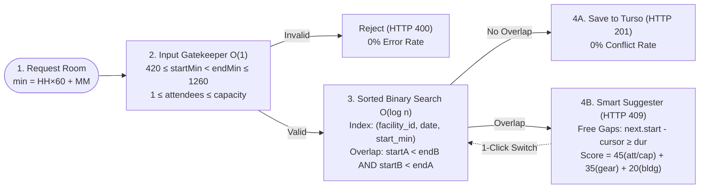
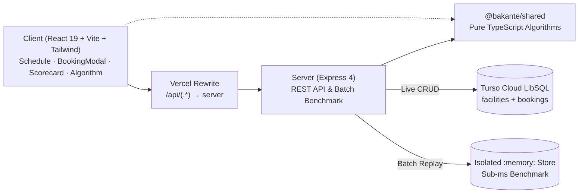

# Bakante — ISATU Real-Time Facility & Room Booking System

**Tech4ISATU Hackathon 2026 · Track 5: University Operations (Facility & Room Booking)**

> **Bakante** (Hiligaynon/Filipino for *"vacant / available"*) replaces manual walk-in forms and error-prone spreadsheets at Iloilo Science and Technology University (ISATU) with a real-time booking calendar that mathematically prevents double-bookings, blocks invalid entries, supports Excel/CSV batch imports, and recommends best-fit alternative rooms in one click.

---

## 1. System Flow & Architecture Diagrams

Open [`Bakante.drawio`](./Bakante.drawio) in Draw.io or the VS Code Draw.io extension to view or export all three slide-ready diagrams:
1. **1. Booking & Conflict Flow** — End-to-end validation, Binary Search, and Best-Fit suggestion loop.
2. **2. System Architecture** — React/Vite client, Vercel `/api` routing, Express API, `@bakante/shared` pure logic, and Turso Cloud LibSQL + `:memory:` replay engine.
3. **3. 3-Way Scorecard Flow** — Manual Walk-In (`360s`) vs. Bakante Manual Form (`120s`) vs. Bakante Batch Excel/CSV Import (`~5ms`).

### Booking & Conflict-Prevention Flow



### Full-Stack Architecture



---

## Quick Equations Reference

1. **Time Normalization (`timeUtils.ts`)**:
   $$\text{minutes} = (\text{HH} \times 60) + \text{MM}$$
   *Example:* `09:30` $\rightarrow$ `(9 × 60) + 30 = 570`

2. **Half-Open Interval Overlap Rule (`timeUtils.ts`)**:
   $$\text{Overlap} \iff (\text{start}_A < \text{end}_B) \;\land\; (\text{start}_B < \text{end}_A)$$
   *Back-to-back (`09:00–11:00` & `11:00–13:00`):* `540 < 780` (true) AND `660 < 660` (false) $\rightarrow$ **Allowed**.

3. **Input Gatekeeper Bounds (`validateBooking.ts`)**:
   $$420 \le \text{startMin} < \text{endMin} \le 1260 \qquad\text{and}\qquad 1 \le \text{attendees} \le \text{room.capacity}$$
   *Campus hours:* `420` = `07:00`, `1260` = `21:00`.

4. **Best-Fit Alternative Room Score (`suggestAlternatives.ts`)**:
   $$\text{Score} = 45 \left(\frac{\text{attendees}}{\text{room.capacity}}\right) + 35 \left(\frac{\text{matchedAmenities}}{\text{requiredAmenities}}\right) + 20 \cdot \mathbb{I}(\text{sameBuilding})$$
   *Example (50 attendees, Projector, Academic Bldg):* `AVR 2` (cap 80) = `28 + 35 + 20 = 83%`.

5. **Official Hackathon Scorecard Formula (`calculateMetrics.ts`, Section 9.1)**:
   $$\text{\% Improvement} = \frac{|\text{Baseline} - \text{New}|}{\text{Baseline}} \times 100$$
   - *Processing Time (Bakante Manual Form):* `|360 − 120| ÷ 360 × 100 = 66.67% faster`
   - *Processing Time (Bakante Batch Excel/CSV):* `|360 − 0.005| ÷ 360 × 100 = 99.99% faster`
   - *Conflict Rate:* `|30.0 − 0.0| ÷ 30.0 × 100 = 100.0% reduction`
   - *Error Rate:* `|20.0 − 0.0| ÷ 20.0 × 100 = 100.0% reduction`

---

## 2. How Every Algorithm & Logic Step Works

Every core algorithm lives in clean, zero-I/O TypeScript modules inside [`shared/src/logic/`](./shared/src/logic/), compiled to `shared/dist/` so the exact same code runs in the browser, API, CLI benchmark, and tests.

### Step 1: Input Gatekeeper (`shared/src/logic/validateBooking.ts`) — $O(1)$
Before querying the database, Bakante validates 5 strict rules:
1. **No blank required fields** (`requesterName`, `office`, `eventTitle`).
2. **Official Room ID check** against the 9 ISATU facilities (stops typos like `"AVR 01"` vs `"AVR-1"`).
3. **Valid time & campus hours** (`07:00` to `21:00`).
4. **Chronological order** (`startTime < endTime`, stopping inverted times like `14:00–12:00`).
5. **Capacity guard** (`1 <= attendees <= facility.capacity`, stopping 120 attendees from booking a 45-seat lab).

**Result:** **0% Error Rate**.

### Step 2: Sorted Binary Search Conflict Check (`shared/src/logic/checkConflict.ts`) — $O(\log n)$
- In a manual spreadsheet, staff scan every row top-to-bottom ($O(n)$) and easily miss overlapping spans.
- In Bakante, bookings are indexed by `(facility_id, date, start_min)` in ascending order.
- `checkConflictBinarySearch()` uses **Binary Search** to jump straight to the requested start minute in $\log_2(n)$ steps, then checks only immediate neighbors until `candidate.startMin >= requestedEndMin`.

**Result:** **0% Double-Bookings** while cleanly allowing back-to-back bookings.

### Step 3: Best-Fit Room & Open-Slot Suggester (`shared/src/logic/suggestAlternatives.ts`)
When a room is busy, Bakante computes two recovery paths:
1. **Open Time Slots on the Same Room (`findFreeSlotsOnSameRoom`)**: Sweeps `[07:00, 21:00)` around existing bookings to find free windows $\ge$ requested duration, sorted closest to the preferred start time.
2. **Ranked Alternative Rooms (`suggestAlternativeRooms`)**: Filters conflict-free rooms that fit `attendees` and scores them out of **100%** (`45` capacity fit + `35` equipment match + `20` same building) so a 50-person class is matched to `AVR 2` (80 seats) rather than wasting the 500-seat `Multi-Purpose Gym`.

### Step 4: 3-Way Scorecard & Batch Import (`shared/src/logic/calculateMetrics.ts` & `server/src/benchmark.ts`)
Compares all three workflows on the exact 20-request dataset (`10` valid, `6` conflict traps = `30.0%`, `4` error traps = `20.0%`):
1. **Manual Walk-In & Spreadsheet**: `360.0 sec` (`18.0 s/req`), `30.0%` conflicts, `20.0%` errors.
2. **Bakante Manual (1-by-1 UI Form)**: `120.0 sec` (`6.0 s/req` — `66.67% faster`), `0.0%` conflicts, `0.0%` errors.
3. **Bakante Batch (Excel / CSV Import)**: `~0.005 sec` (`~0.24 ms/req` — `99.99% faster`), `0.0%` conflicts, `0.0%` errors.

---

## 3. Project Structure

```text
hackathon/
├── Bakante.drawio                  # 3-page Draw.io diagrams (Booking Flow, Architecture, 3-Way Scorecard)
├── vercel.json                     # Vercel multi-service config (client Vite + server Express)
├── README.md                       # Complete system documentation
├── package.json                    # Monorepo scripts (dev, test, benchmark, build)
│
├── baseline/                       # 20-Request Baseline & Excel Kit
│   ├── facilities.json             # 9 ISATU Campus facilities & capacities
│   ├── dataset.json / .csv / .xlsx # 20 requests: 10 valid, 6 conflict traps, 4 error traps
│   ├── manual_log_template.csv     # Blank sheet for manual timing
│   ├── manual_test_protocol.md     # QA manual timing guide
│   └── manual_results.json         # Verified 360s / 6 conflicts / 4 errors baseline
│
├── shared/                         # Pure TypeScript logic (compiled to shared/dist/)
│   ├── src/types.ts                # Shared domain & benchmark interfaces
│   ├── src/logic/timeUtils.ts      # Minutes-from-midnight & doTimesOverlap()
│   ├── src/logic/validateBooking.ts# Step 1: O(1) Input Gatekeeper
│   ├── src/logic/checkConflict.ts  # Step 2: O(log n) Binary Search conflict check
│   ├── src/logic/suggestAlternatives.ts # Step 3: Open slots & 100-pt Best-Fit rooms
│   ├── src/logic/calculateMetrics.ts    # Section 9.1 % Improvement & 3-way Scorecard
│   └── tests/logic.test.ts         # 6 unit tests
│
├── server/                         # Express 4 API + Turso Cloud LibSQL (@libsql/client/web)
│   ├── src/db.ts                   # Turso LibSQL + fast :memory: schedule engine
│   ├── src/baselineData.ts         # Embedded fallback data for serverless deploys
│   ├── src/routes.ts               # REST endpoints (/api/bookings, /api/benchmark/import)
│   ├── src/benchmark.ts            # 20-request & Excel batch benchmark engine
│   ├── src/benchmarkCli.ts         # CLI runner for `npm run benchmark`
│   ├── src/index.ts                # Express app export (Vercel serverless + local server)
│   └── tests/api.test.ts           # 3 integration & batch replay tests
│
├── client/                         # React 19 + Vite + Tailwind web app
│   ├── public/logo.png             # Bakante favicon & navbar logo
│   └── src/
│       ├── App.tsx                 # Top 4-card live dashboard, day arrows, filters & navigation
│       └── components/
│           ├── CalendarGrid.tsx    # 14-hour facility grid + skeleton loading + booking details
│           ├── BookingModal.tsx    # User-friendly booking form + Best-Fit room cards
│           ├── BenchmarkDashboard.tsx # 3-way Scorecard + Excel/CSV import (SheetJS)
│           └── LogicExplainer.tsx  # Interactive overlap rule tester
│
└── docs/
    ├── metrics_declaration.md      # Metrics Declaration Form reference
    └── scorecard.md                # Auto-generated Section 9.4 Scorecard
```

---

## 4. Setup, Commands & Deployment

### Prerequisites
- **Node.js 22+** (Node 24 recommended) and **npm**.
- **Turso Database** (`TURSO_DATABASE_URL` and `TURSO_AUTH_TOKEN` in `.env` — see `.env.example`).

### Local Commands
```powershell
# 1. Install dependencies
npm install

# 2. Start API (http://localhost:4000) + Frontend (http://localhost:5173)
npm run dev

# 3. Run all 9 unit & integration tests
npm test

# 4. Run 20-request CLI benchmark & update docs/scorecard.md
npm run benchmark

# 5. Build shared + client production bundles
npm run build
```

### Vercel Deployment
1. Push the repository with [`vercel.json`](./vercel.json) to GitHub.
2. In Vercel Project Settings $\rightarrow$ **Environment Variables**, add `TURSO_DATABASE_URL` and `TURSO_AUTH_TOKEN`.
3. Deploy — `/api/*` routes automatically to the Express serverless function and `/*` serves the Vite frontend.

---

## 5. Purpose & Why It Matters

### Overall Purpose
ISATU offices still rely on walk-in requests, paper forms, and unvalidated spreadsheets to reserve campus rooms—leading to slow manual lookups (`~360s` for 20 requests), double-booked events (`30%` conflict rate in test traps), and invalid entries like room typos or overcrowded classes (`20%` error rate). **Bakante** turns room booking into an automated, conflict-proof system so staff and faculty know what is vacant in real time.

### Why Each Part Matters
| Component / Rule | Purpose | Why It Matters |
|---|---|---|
| **Input Gatekeeper (`O(1)`)** | Validates required fields, room IDs, campus hours (`3 AM–11 PM`), and seat capacity before saving. | Eliminates typos (e.g. `AVR 01`) and unsafe overcrowding (`120` students in a `45`-seat lab) $\rightarrow$ **0% Error Rate**. |
| **Half-Open Interval Rule (`startA < endB && startB < endA`)** | Checks exact time overlap using minutes from midnight (`HH × 60 + MM`). | Blocks every real overlap while safely allowing back-to-back events (`9–11 AM` followed by `11 AM–1 PM`). |
| **Sorted Binary Search (`O(log n)`)** | Jumps directly to the target time window instead of scanning every row top-to-bottom. | Scales fast even as bookings grow across semesters, keeping conflict checks at **0% Double-Bookings**. |
| **Best-Fit Score (`45` seat fit + `35` gear + `20` same bldg)** | Ranks free alternative rooms out of `100%` when your first-choice room is busy. | Recommends `AVR 2` (80 seats, `83%`) for 50 people instead of wasting the 500-seat `Multi-Purpose Gym` (`40%`), while keeping equipment and building proximity intact. |
| **Excel / CSV Batch Import** | Lets offices upload existing `.xlsx` or `.csv` schedules in one click. | Cuts 20-request processing from `360.0s` (walk-in) down to `~0.003s` (`99.99% faster`) without manual re-encoding. |

